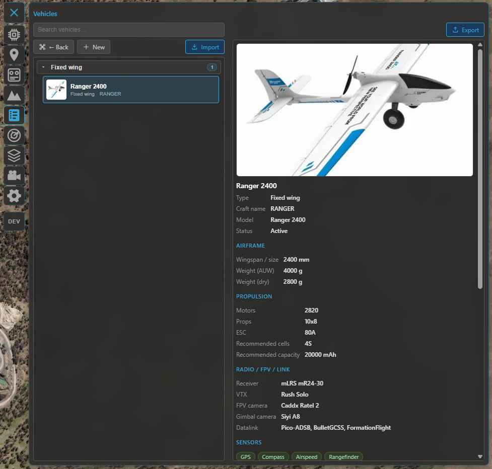
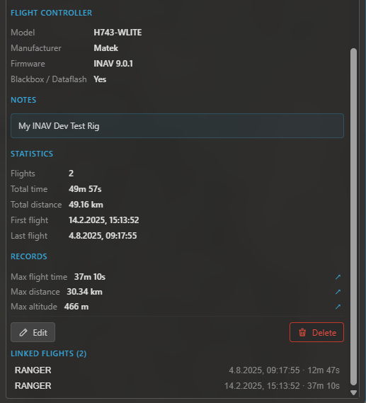

# Vehicles

The vehicle library is a catalogue of your aircraft — a structured **build sheet** for each one, plus
its flight history. Every flight stores the vehicle it belongs to, recognised when the flight is saved by
the flight controller's **FC hardware ID**, or by its **craft name** — so the library fills itself in as
you fly. It's a subfeature of the **[logbook](logbook.md)**: open it with the **Vehicles** button in the
logbook toolbar.

## The vehicle list

Vehicles are grouped by **type** and can be **searched** (by name, craft name, model, type, notes,
flight controller or FC hardware ID). Each row shows the name, and below it the type, the craft name —
or the shortened FC hardware ID for a vehicle without one — and the model. Pick one to open its build
sheet; the toolbar also creates a new vehicle and imports one from a file. While connected over INAV or MAVLink, the
[UAV Info panel](telemetry-and-display.md#uav-info-panel) can also save the connected craft here in one click.

/// caption
The vehicle library — your aircraft grouped by type, with search and per-vehicle build sheets.
///

## The build sheet

Each vehicle is a structured record you can fill in as much (or as little) as you like:

- **Identity** — name, **craft name** (a link key — see below), **type** (fixed-wing, flying-wing,
  VTOL, multirotor, helicopter, rover, boat, other) and **status** (active, storage, retired, damaged,
  **crashed**), plus a header **image** and free-form notes.
- **Airframe** — model, wingspan, length, all-up weight and dry weight.
- **Propulsion** — motors, propellers, ESC, and a recommended battery (cells / capacity).
- **Radio, FPV & datalink** — receiver, video transmitter, camera, gimbal camera, datalink.
- **Sensors** — checkboxes for GPS, RTK, compass, airspeed, rangefinder and optical-flow.
- **Flight controller** — model, manufacturer, firmware and version, whether blackbox is available, and
  the **FC hardware ID** (filled in automatically when the vehicle is created from the connected craft
  via the UAV Info panel) — the first key flights are recognised by, see below.

/// caption
A build sheet: image header, structured specs, lifetime stats and the flights linked to this aircraft.
///

## Linking flights

Each flight stores the vehicle it belongs to. When a flight is saved — a live recording, a log import or
a `.kflight` import — Kite looks for its vehicle:

1. the vehicle whose **FC hardware ID** is the one the flight was flown with,
2. else the vehicle whose **craft name** matches the flight's (ignoring case and surrounding spaces).

If several vehicles match, the newest one wins. **When unsure, the flight stays unassigned:** a flight
with an FC ID is never linked by craft name to a vehicle that stores a *different* FC ID (a swapped
flight controller, or a second aircraft with the same name) — you decide on the post-flight summary, or
later in the logbook. A flight keeps the FC ID it was flown with and its
recorded craft name (unless you correct the name with ✎ in the logbook); the link to the vehicle is
stored next to them and can be changed at any time.

- **INAV** reports both — the craft name and the FC ID (also over **MSP/MAV**).
- **ArduPilot / PX4** report an FC ID but no craft name: pick the vehicle once on the post-flight
  summary, and Kite offers to store the FC ID in that vehicle — from then on its flights are recognised
  by themselves. Picking the vehicle later in the logbook links only that one flight.
- **No FC ID** comes from telemetry-only links, from imported logs (they link by craft name), from
  **INAV over plain MAVLink** (without MSP/MAV), and from simulators that report a placeholder instead
  of a real ID (INAV SITL, PX4 SITL as system ID 1).

**After a flight** the post-flight summary shows the vehicle it was recognised as, with a picker to choose
another one or none. After **Save** Kite asks when the choice raises a question:

- the vehicle has **no FC ID yet** but the flight has one → *Store FC ID* (existing flights flown with this
  FC ID or the vehicle's craft name that belong to no vehicle yet are linked too);
- the vehicle has a **different FC ID** → *FC swapped — replace ID* (the vehicle keeps all its earlier
  flights and gets this one), *Create new vehicle* (a second aircraft with the same craft name) or
  *Leave unassigned* (the flight belongs to no vehicle; link it later in the logbook);
- **no vehicle** matched → *Create vehicle* opens the Manager pre-filled from the flight, and the flight
  belongs to the new vehicle once it is saved. A flight with neither a craft name nor an FC ID gets no
  such offer.

**An FC ID belongs to one vehicle.** When *Store FC ID* or *replace ID* gives a vehicle an FC ID that
another vehicle stores, the question names that vehicle, and answering yes removes the ID there. Entering such an FC
ID on a build sheet, or importing a `.kvehicle` that carries one, asks first whether to move it — Cancel
saves nothing. *Save to vehicle library* in the UAV Info panel never creates a second vehicle with an
FC ID that is already in the library.

**Existing flights are only re-linked with your OK.** After creating a vehicle (here, from the post-flight
summary, from a flight in the logbook, with *Save to vehicle library* in the UAV Info panel or by a
`.kvehicle` import), after changing its craft name, and after entering an FC ID on a vehicle that had
none, Kite counts the logged flights flown with the vehicle's craft name or its FC ID that belong to no
vehicle yet and asks whether to link them — a flight flown with a different FC ID is never counted by
its craft name. **Swapped the flight controller?** Replace the FC ID on the build sheet: the earlier
flights stay with the vehicle and the new FC's flights are recognised by the new ID. Kite asks only when
flights flown with the new FC ID are already in the logbook without a vehicle (it offers to link
those).

Each vehicle then shows its **lifetime totals** (flight count, time, distance) and the **list of linked
flights**, jump-to-able from the build sheet. A **`.kflight`** export does not carry the link (the
library is local); importing it recognises the vehicle again in the receiving library.

## INAV extras

When an **INAV** flight controller is connected (and disarmed):

- **Write to FC** — push the build sheet's craft name to the FC, so its future flights carry the same
  craft name as the vehicle.
- **Adopt FC lifetime stats** — read the FC's onboard `stats` totals (if the feature is enabled) and
  stage them as the vehicle's **lifetime baseline**; saved, they're added to the logbook flights so the
  totals reflect the airframe's whole life, including flights from before you used Kite.

## Deleting a vehicle

Deleting a vehicle never deletes flights. With linked flights, the dialog offers to **transfer** them to
another vehicle first (pick it from the list — handy when an aircraft is replaced and its pilot keeps the
history), or to **delete without transfer**: the flights stay in the logbook and belong to no vehicle.

## Import & export

Move a vehicle between installs (or back it up) with a **`.kvehicle`** file — export the open vehicle, or
import one (with a preview before it's added). The lifetime baseline travels with the file.

## Where to go next

- Where vehicles link from: **[Flight logbook](logbook.md)**.
- The other logbook library: **[Batteries](batteries.md)**.
