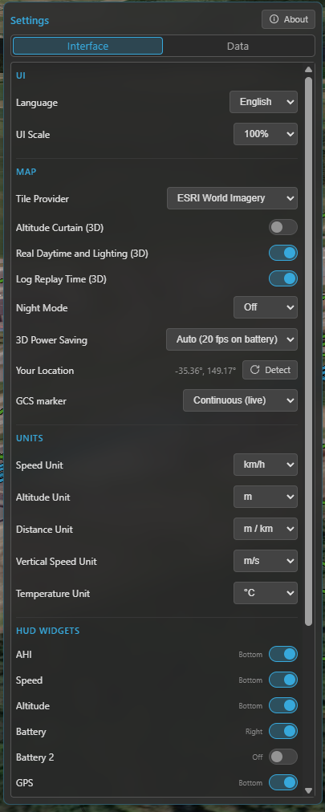

# Settings

A reference for every option in the **Settings** tool (navigation rail). Settings are split across three
tabs: **Interface** (how Kite looks, the units it uses, alerts, language and updates), **Map** (the 3D
view, mission defaults, map and data providers, caches) and **Data** (telemetry, the flight logbook and
diagnostics). Changes apply immediately and are remembered between sessions.

Number fields with **+ / −** buttons also take the mouse wheel: click into the field, then turn the
wheel — up increases, down decreases, and turning fast steps in bigger increments. A field you haven't
clicked into ignores the wheel, so scrolling the panel never changes a value by accident.

/// caption
The Settings panel, grouped into labelled sections.
///

## Interface tab

### Display

| Setting | What it does | Default |
|---|---|---|
| **Map Provider** | The map imagery source — used by **both the 2D map and the 3D globe**. After the built-in maps the list shows your custom online providers under **Custom online maps**; on the desktop it ends with your offline maps under **Custom offline maps**, each marked **▦**. Both are set up under **[Providers](#providers)** (Map tab). See **[Your own maps](../guides/custom-maps.md)**. | ESRI Hybrid |
| **Night Mode** | Dim the 2D map at night — Off / Auto (by local time) / On. | Auto |
| **Power Saving** | Cap the 3D frame rate to save battery — Off (60 fps) / On (20 fps) / Auto (20 fps on battery). While active it also drops the smooth bar animations in the speed and battery widgets, so those read the current value directly, and the frosted-glass blur behind panels and widgets. On phones and tablets the glass blur over the map is always off; only the panels keep it. | Auto |
| **Your Location** | Your detected position (used as a fallback reference). **Detect** re-runs OS geolocation. | — |
| **GCS marker** | How the ground-station position is sourced — Off / Manual (draggable — place it once; **Reset** snaps it back to *Your Location*) / Continuous (live). Used as the reference when no aircraft fix is available. While your own position is still unknown, the aircraft's home position stands in for it. | Continuous |

### HUD Widgets

Toggle each **widget** on or off; the indicator shows which dock it currently lives in. For what each
widget shows, see the **[Quick tour](../getting-started/quick-tour.md)**. By default Battery, Speed, AHI,
Altitude and Compass sit in the bottom dock and Home, RC Link and GPS in the right dock; the rest are off.

### Units

These are **global** — every widget, map read-out and panel follows them. See
**[Telemetry & display](../guides/telemetry-and-display.md)**.

| Setting | Options | Default |
|---|---|---|
| **Speed** | km/h · mi/h · m/s · ft/s · kt | km/h |
| **Altitude** | m · ft | m |
| **Distance** | m / km · ft / mi | m / km |
| **Vertical speed** | m/s · ft/s | m/s |
| **Temperature** | °C · °F | °C |

### Alerts

| Setting | What it does | Default |
|---|---|---|
| **Altitude** | The altitude above which the aircraft is flagged (also the reference for altitude track-colouring). | 120 m |
| **Battery alert** | The charge % at which the battery widget enters its alert state (and multi-battery AUTO drops to the lowest pack). See **[Batteries](../guides/batteries.md)**. | 30 % |
| **System messages** | How many in-app notifications to show — Off / Error / Warning / All / Debug. *All* shows everything up to the firmware's info level; *Debug* adds its developer-level texts (MAVLink severity *debug* — ArduPilot's "Sending unknown message …", for example), without a sound. **Currently MAVLink (ArduPilot / PX4) only** — INAV has no equivalent message source. | Warning |

### UI

| Setting | What it does | Default |
|---|---|---|
| **Language** | The UI language — English, Deutsch, Français, 中文, Български, Slovenčina or Español. | English |
| **UI Scale** | Scale the whole interface — 100 %, 125 % or 150 % (for high-DPI or far-away screens). | 100 % |
| **Default Protocol** | Which protocol the connection bar starts on. **Last used** restores whatever you connected with last time, which is what Kite has always done. Pin it to **MSP**, **MAVLink** or **Telemetry** and that choice wins on every launch, whatever the last session used. Kite still remembers the last-used protocol, so switching back to **Last used** picks up where you left off. | Last used |

### Updates

| Setting | What it does | Default |
|---|---|---|
| **Check for updates** | Whether Kite asks GitHub for a newer version when it starts — **Disabled**, **Stable releases**, **Patch releases only** (bug-fix releases of the version you run, e.g. 2.0.0 → 2.0.1, never 2.1.0), or **Include pre-releases** (betas and release candidates). | Stable releases |

Kite never downloads anything on its own. When a newer version exists you get a notice with the
version you have, the one that is available, and the release notes, plus four choices:

- **Update and Restart** downloads the new version, installs it and restarts Kite. On Windows and
  Linux this runs the installer of the package you installed (a `.deb`/`.rpm` asks for your password);
  on macOS the app bundle is replaced in place. A **portable** copy replaces its own executable and
  restarts. Android has no in-app install and no store listing yet, so the notice there offers only
  the other three choices.
- **Open Release Page** shows the release on GitHub in your browser, with every download.
- **Remind me later** asks again at the next start.
- **Skip this version** suppresses the notice for that one version only.

On iPhone and iPad the update check is switched off and this section is hidden. TestFlight and the
App Store tell you about new versions themselves, and GitHub releases have no iOS build.

## Map tab { #map }

### 3D View

| Setting | What it does | Default |
|---|---|---|
| **Altitude Curtain (3D)** | Draw the vertical wall from the flight track down to the ground in 3D. An installation that already had this setting keeps its value. See **[3D map](../guides/map-3d.md)**. | Off |
| **3D Buildings (OSM)** | Show OpenStreetMap building extrusions on the 3D globe. The buildings come from Cesium Ion, so the switch stays greyed out until a **Cesium Ion Token** is entered (**[Providers](#providers)**, below). | Off |
| **Real Daytime and Lighting (3D)** | Light the 3D globe with the real sun position (day / night, shadows). | On |
| **Log Replay Time (3D)** | During replay, drive that lighting from the log's actual time of day (needs the option above). | On |
| **High-Resolution 3D** | Render the 3D globe at the display's native pixel density (on) or at half of it (off) to save GPU and battery. Switched off on a standard-density screen, the globe also loads its online map tiles up to one zoom level coarser — as few as a quarter of the tiles, which is all the half-resolution picture can show. On high-density screens (phones, tablets, HiDPI laptops) the tiles stay as they are, because half the density still shows them fully. Sharpest on high-DPI phones and tablets; a laptop with a weak integrated GPU may prefer it off. | On (desktop) · Off (phone / tablet) |

### Mission Control

| Setting | What it does | Default |
|---|---|---|
| **Default waypoint altitude** | The altitude new waypoints get when you place them. | 50 m |
| **Default PosHold time** | The default loiter time for a new hold waypoint. | 30 s |

See **[Missions](../guides/missions.md)**.

### Providers

| Setting | What it does | Default |
|---|---|---|
| **Custom Offline Map Location** *(desktop only)* | The folder Kite reads custom maps from, one subfolder per map — **Choose** another folder or **Use Default**. Below it: how many maps were found, **Show map area** (moves the map to the area the selected custom map covers; shown only while one is selected) and **Rescan** (read the folder again, e.g. after adding tiles or plugging in the drive). You pick the map itself under **Map Provider** (**[Display](#display)**, Interface tab). See **[Custom maps from a folder](../guides/custom-maps.md#custom-maps-from-a-folder)**. | `custom_maps` in Kite's app data folder |
| **Custom Online Provider** | How many online tile services you added (**None**, **1 provider**, …). **Manage** opens the list: **Add provider**, **Edit**, **Delete**, and in the form a **Test** that loads one tile. Each provider is given by its URL template (an API key is simply part of the URL), with a max zoom, a tile size (256 / 512 / 128 px) and an optional attribution. See **[Custom online providers](../guides/custom-maps.md#custom-online-providers)**. | None |
| **Cesium Ion Token** | Your free Cesium Ion token, which enables real-world 3D terrain. See **[3D map](../guides/map-3d.md)**. | (none) |
| **Airspace Manager** | Enable the aeronautical overlay, pick the **provider** (OpenAIP) and enter its **API key**. See **[Airspace Manager](../guides/airspace.md)**. | On, no provider set |

### Cache

| Setting | What it does | Default |
|---|---|---|
| **Tile Cache** | On-disk cache size for the map imagery (off … 5 GB), with a usage bar and **Clear**. Used by **both 2D and 3D**, and what makes the map work **offline**. Custom online providers use it like the built-in maps; custom offline maps are read from disk and never go into this cache. | 200 MB |
| **Terrain Cache** | Disk cache for the Copernicus terrain used by terrain analysis (size read-out + **Clear**). | — |

## Data tab

### Telemetry

Kite polls the link at just **two** configurable rates — **Attitude** and **GPS / Position**. Everything
else is *derived* from those: a few fields ride along with (a fraction of) those polls, and the remaining
data — status, battery, flight mode, RC link, … — refreshes at roughly **1 Hz**. So these two rates set
how smooth the instruments feel; the rest is automatic.

| Setting | What it does | Default |
|---|---|---|
| **Attitude** | Attitude (AHI / compass) update rate — 1–5 Hz. Higher is smoother but uses more link bandwidth. | 5 Hz |
| **GPS / Position** | Position / speed / altitude update rate — 1–5 Hz. | 2 Hz |
| **Airspeed** | Request airspeed telemetry (when the aircraft has an airspeed sensor). | On |
| **Wind** | Request wind-estimate telemetry (shown on the compass widget). Live wind needs **ArduPilot** or **PX4**, or **INAV 10.0+** — on older INAV the toggle stays without effect. Replay always shows the wind a log recorded. | Off |
| **Direction indicators** | Draw the heading / course / predicted-turn lines at the aircraft on the map. | On |
| **Full MAVLink Telemetry** | MAVLink only — hand rate control to the flight controller (streams everything at its own rates, ignoring the two rates above). For fast links / full `.tlog` capture. See **[Telemetry & display](../guides/telemetry-and-display.md)**. | Off |
| **Telemetry API** | Serve the live telemetry to other programs as JSON, read-only: a **TCP stream** (port 27300), an **HTTP snapshot** (port 27301) and/or **UDP subscribers** (port 27300, a client subscribes by sending the word `subscribe`); **Reachable on the network** switches the listeners from loopback to all interfaces; **Update rate** 1–10 Hz. The status line shows the endpoints and connected clients. Full contract: **[Telemetry API](telemetry-api.md)**. | Off |
| **Radar tracking** | Master switch for foreign-vehicle radar, with per-system enables (**ADS-B**, **FormationFlight**). See **[Radar & ADS-B](../guides/radar-and-adsb.md)**. | On (ADS-B on) |
| **RC Control** | Enable GCS RC control (reveals the RC tool). See **[RC control](../guides/rc-control.md)**. | Off |

**Airspeed** and **Wind** each request **extra messages** over the link, so they're separate toggles —
switch them off to save bandwidth on a slow over-the-air radio, and on when the link can spare it.

### Flight Logbook

| Setting | What it does | Default |
|---|---|---|
| **Enable flight logging** | Record a flight-summary entry per flight in the logbook. | On |
| **Enable flight recording** | Record the full telemetry track for replay. | On |
| **Raw flight logs** | Also keep the raw MSP/MAVLink stream (`.rawmsp` / `.tlog`) for each recording. | Off |
| **Continuous raw logging** | Record the raw stream the whole time connected, not just while armed. | Off |
| **Flight log database** | Where the logbook database lives — **Choose** a path or **Use default**. | default path |
| **Compact Database** *(desktop only)* | Rebuild the database file to reclaim space (rarely needed — deleting flights already frees space in the background). Kite shows a blocking notice until it is done; on a hard disk or an SD card this can take several minutes. If a flight is being recorded or an import is running, Kite refuses with a message. While it runs it needs free space: up to the size of the database next to the database file, and about the same again in the system's temporary folder. On Android and iOS the button is not shown: the database holds no original log files there, and deleting flights already gives the space back. | — |
| **Database backup (pre-update)** | Shown only once a backup exists: the backup Kite wrote before it last upgraded the database format, with its size and a **Delete** button. See **[Flight logbook](../guides/logbook.md#the-database-updates-and-the-automatic-backup)**. | — |
| **Raw log path** | Where raw `.rawmsp` / `.tlog` files are written. | default path |

See **[Flight logbook](../guides/logbook.md)** for how these are used.

### Diagnostics

| Setting | What it does | Default |
|---|---|---|
| **Log level** | How much Kite writes to its diagnostic log file — Off / Error / Warning / Debug. Raise it when reporting a problem. | Warning |
| **Open log folder** | Open the folder containing the diagnostic log in your file manager. Kite writes one file per day and keeps the last 30 days. | — |
| **Share log file** (Android) | Replaces **Open Folder** there — the log folder is app-private, no file manager can reach it. Opens a list of the day files, newest first, each with its date and size and the one this session writes tagged **current**; tap one to hand it to the Android share sheet (mail, messenger, a text editor). **Close** dismisses the list. | — |

## See also

- The interface map: **[Quick tour](../getting-started/quick-tour.md)**.
- File formats Kite reads and writes: **[File formats](file-formats.md)**.
